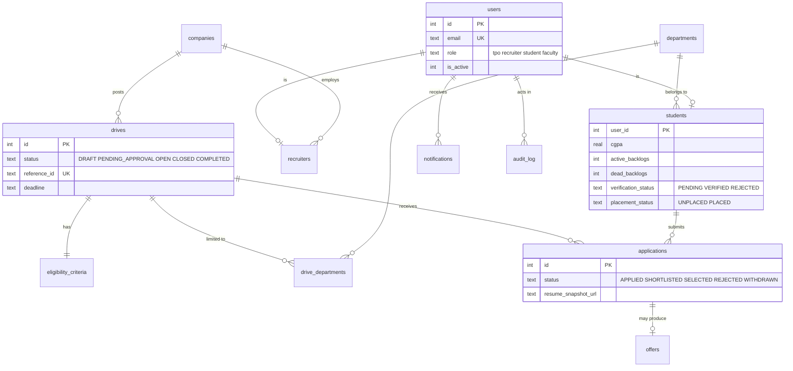

# CRATS

Campus Recruitment & Application Tracking System for SPIT Mumbai: a role-based campus placement platform. Recruiters create drives, the TPO approves them, and verified students check eligibility, apply and track applications. Light and dark themes.

Next.js 16 (App Router) + React 19 + Tailwind v4 on the front; Route Handlers + SQLite (better-sqlite3, plain SQL) on the back; zod validation; bcrypt passwords; signed httpOnly session cookie.

## Run it (3 commands)

```bash
pnpm install
pnpm db:seed     # creates data/crats.db with the demo data (drops and recreates everything)
pnpm dev         # http://localhost:3000
```

No pnpm yet? `npm i -g pnpm`, or prefix the commands with `npx pnpm@12.3.4`. Node 22 or newer.

`pnpm dev` turns the demo helpers on by default. For `pnpm build && pnpm start` copy `.env.example` to `.env.local` (it sets `DEMO_MODE=true`); without it a production start hides the demo accounts and the reset/verification helpers.

Other scripts: `pnpm test`, `pnpm build`, `pnpm typecheck`.

## Demo accounts

Password for every seeded user: **`Crats@2026`**

| Role | Name | Email | Lands on |
|---|---|---|---|
| TPO | Dr. Anil Kulkarni | `tpo@spit.edu` | `/dashboard` |
| Recruiter (TechNova Solutions) | Priya Mehta | `priya.mehta@technova.com` | `/create-drive` |
| Student (Computer Engg, 2027) | Aarav Patel | `aarav.patel@spit.edu` | `/open-drives` |

Also seeded: students Neha Joshi (`neha.joshi@spit.edu`) and Rohan Shah (`rohan.shah@spit.edu`), five more recruiters (one per other company), faculty Prof. Sunita Rao (has no screen in this demo, so she cannot sign in), and a **deactivated** recruiter, `deepak.nair@nimbussoft.com`, to show a blocked login.

There is no login page. Opening any of the three pages while signed out shows a sign-in dialog with three "Use demo account" buttons.

## 6-minute demo script

The demo clock is fixed at **14 Oct 2026, 10:00 IST**, so "2 hours ago" and "days left" read the same on every run. "Reset demo data" (avatar menu) restores the starting state at any time.

1. **Recruiter.** Open `/create-drive` and use *Use demo account → Recruiter*. A rose banner shows the TPO's reason: *the 12th percentage is missing*. Press **Save as draft**: the server rejects it and the 12th field shows its error. Type `75`. Watch the live preview: the pool changes from 67% to **59%** (16 of 27 verified students) and the three sample students show their exact reasons. Press **Submit for TPO approval**, confirm, and note the reference ID and the *Pending approval* chip. The form is now read-only.
2. **TPO.** Avatar menu → *Switch user* → TPO. The dashboard shows 6 open drives, **4** pending approvals, the funnel, department chart, trend and activity feed, all computed from the database. Change the department and date selectors (they re-query). Press **Review** on *Product Engineer* and **Approve**. Press **Review** on *DevOps Engineer*, press **Reject…** and try to confirm with no reason (inline error), then give one. *Export report* downloads the CSV. Open drives are now 7, pending 2, and the activity feed has both actions.
3. **Student.** Switch user → Student. Aarav sees 7 open drives: eligible, not eligible (with the exact unmet rules, e.g. *CGPA 8.2 is below the required 8.5*) and Applied (the Frontend Developer Intern he applied to on 12 Oct). Search "cloud", use the status tabs, type and sort. Press **Apply now** on *Backend Software Engineer*: the card flips to Applied. Open **View criteria** on *Embedded Systems Engineer* for the tick/cross checklist. The bell shows the new notification; open it and mark all as read. Optional: the **Unverified** switch (demo only) turns every Apply button off with a verification message.
4. **TPO again.** The funnel's *Applied* count has gone up by one and the activity feed shows "Aarav Patel applied to Backend Software Engineer".
5. **Access control.** While signed in as a student run `fetch('/api/dashboard').then(r => r.status)` in the browser console: **403**. Signed out it is **401**. Try a wrong password in the dialog (generic message, and an email is locked for 5 minutes after 5 failures) and the deactivated account (*This account is not active*).
6. **Reset.** Avatar menu → *Reset demo data*.

## Architecture

```
app/                    the three pages (dashboard, create-drive, open-drives) + app/api/** route handlers
proxy.ts                Next 16's renamed middleware: "/" and unknown paths -> your own page, wrong role -> your own page
components/             app shell, dialogs, page components (the existing look and tokens in app/globals.css)
server/db/              schema.sql, client.ts (better-sqlite3), seed.ts (deterministic, seeded RNG), seed-cli.ts
server/auth/            session (jose JWT cookie), permissions (role -> permission map), guard, login (bcrypt + lockout)
server/services/        eligibility, drives, student-drives, dashboard, notifications, audit, users
server/lib/             clock (the single DEMO_NOW source), http (error format), env
tests/                  vitest, calling the real route handlers against an in-memory seeded database
```

- **Authorization is in the API**, never only in the UI. Every route calls `requirePermission()` (401 signed out, 403 wrong role). Row-level scoping is in the service layer: a recruiter sees only their company's drives, a student only their own applications and only `OPEN` drives, the TPO everything.
- **One eligibility function** (`server/services/eligibility.ts`) powers the live preview, the student list, the details dialog, the apply endpoint and the seed. `NULL` criteria mean "no constraint".
- **Multi-step writes are transactions** (apply, submit, review). Every privileged action writes an append-only `audit_log` row (database triggers block updates and deletes) and its notification in the same transaction.
- Why plain SQL and no ORM: a small schema that is easier to read in a classroom; `server/db/schema.sql` is the whole truth. better-sqlite3 v13 ships a prebuilt binary, so no compiler is needed (`pnpm-workspace.yaml` explicitly declines its install script; the release-age rule is untouched).

### Entity relationships



`applications` has `UNIQUE(drive_id, student_id)`, `offers` has `UNIQUE(application_id)`, and `audit_log` is append-only.

## Dashboard definitions

| Figure | Definition |
|---|---|
| Registered students | Rows in `students` (department filter applies). "+N this month" = student accounts created in the last 30 days. |
| Placed students | Students with `placement_status = PLACED`; "% of registered" is placed / registered. |
| Average CTC | Mean `ctc` of `ACCEPTED` offers answered inside the selected range. The delta compares the last 7 or 30 days with the 7 or 30 days before. |
| Open drives | Drives with status `OPEN`; "closing this week" = deadline within the next 7 days. |
| Funnel | Applications applied inside the range: *Shortlisted* = `SHORTLISTED` + `SELECTED`, *Selected* = `SELECTED`, *Offers accepted* = applications whose offer is `ACCEPTED`. "conv." is the share of the previous stage. |
| Trend | Accepted offers per week for 12 weeks, cumulative. |

The department filter applies to every figure. The date range applies to the funnel, top companies and average CTC; counts of students and drives are always current totals.

## API (all under `/api`)

| Endpoint | Who |
|---|---|
| `POST /auth/login`, `POST /auth/logout`, `GET /auth/me` | anyone (`me` answers `user: null` when signed out) |
| `GET /dashboard`, `GET /dashboard/export` (CSV) | TPO |
| `POST /drives/:id/review` `{action, reason}` | TPO |
| `GET /drives/:id` | scoped by role |
| `GET /draft`, `PUT /draft`, `POST /draft/submit`, `POST /eligibility/preview` | Recruiter |
| `GET /student/drives`, `GET /student/drives/:id`, `POST /student/drives/:id/apply` | Student |
| `GET /notifications`, `POST /notifications/read` | any signed-in user |
| `POST /demo/reset`, `POST /demo/verification` | demo mode only |

Errors are always `{ "error": { "code", "message", "fields?" } }`.

## Notes and limits

- The seed is deterministic (seeded RNG, fixed clock). Only the bcrypt salts differ between runs.
- Faculty accounts exist in the data model but have no screen, so they cannot sign in here.
- The sidebar items that have no page (Companies, My Applications, ...) show an "outside the demo scope" toast.
- The login lockout counter lives in memory, so it resets when the server restarts.
